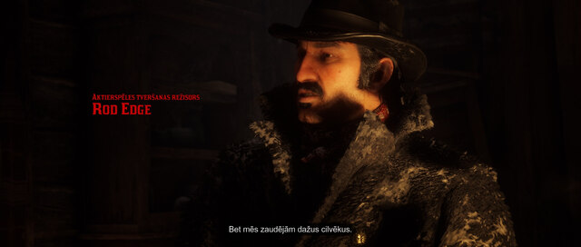
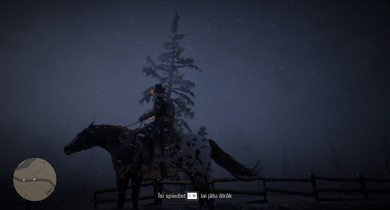
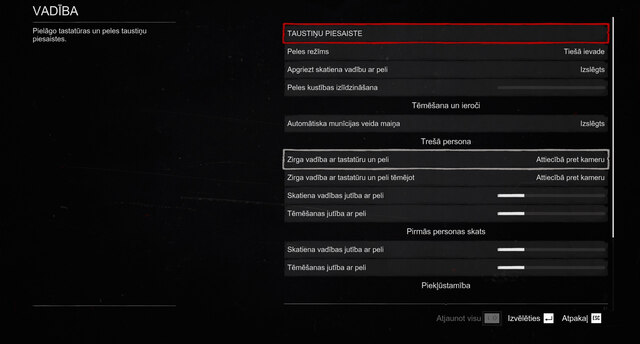
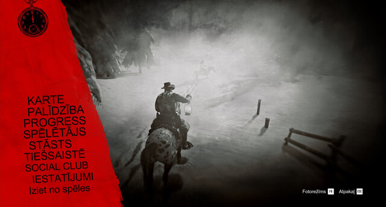
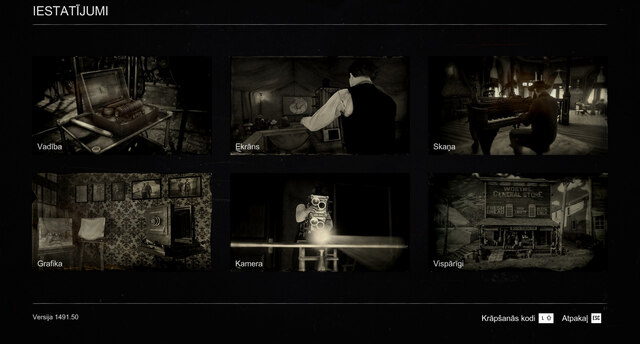
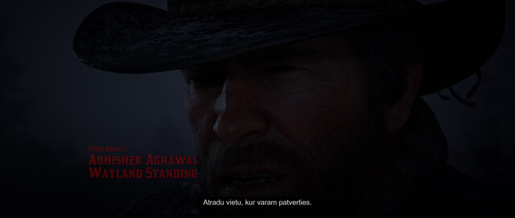

# REYRUN · Red Dead Redemption 2 latviski

Latviski · [English](README.md) · [Русский](README.ru.md)

Jūs spēlējat Red Dead Redemption 2. Dačs kaut ko stāsta, bet, kamēr mēģināt saprast vienu teikumu angliski, nākamo jau esat palaiduši garām. Tik labā vesternā gribas saprast katru vārdu.

Oriģinālajā spēlē latviešu valodā nav ne balsu, ne subtitru. Ar mākslīgā intelekta palīdzību esmu iztulkojis subtitrus, izvēlnes un uzdevumus. Varoņi runā angliski, jūs lasāt latviski. Tulkojumu var lejupielādēt, uzstādīt un lietot pilnīgi bez maksas.

Ja Windows datorā jau ir spēle angļu valodā, iekopējiet šīs lapas adresi savā sarunā ar mākslīgo intelektu. Tas palīdzēs uzstādīt tulkojumu.

[https://reyrun-rdr2-latviski.runcisreinis.chatgpt.site/](https://reyrun-rdr2-latviski.runcisreinis.chatgpt.site/)

Ja lietojat ChatGPT, jūs jau sarakstāties ar čatbotu. Lai tas tiktu pie spēles failiem, [savienojiet čatu ar datoru](https://reyrun-chatbot-bridge.runcisreinis.chatgpt.site/).

Šis nav profesionāls tulkojums. Šķirstīju sinonīmu vārdnīcas un salīdzināju, kā tā pati doma izteikta citās valodās. Cik pats esmu spēlējis ar šo tulkojumu, visu varēju saprast. [Ja vēlaties mani atbalstīt, jau iepriekš paldies!](https://reyrun-rdr2-latviski.runcisreinis.chatgpt.site/#support)

Pamācība čatbotam un lejupielādes

Ja uz datora ir tikai spēle angļu valodā, vispirms vajag tulkošanas spraudni un tā ielādētāju. Tos izplata to autori. Čatbots palīdzēs tos sagādāt. Pirmajā reizē var būt jāpierakstās Nexus Mods vai jāapstiprina lejupielāde.

**[Lejupielādēt tulkojuma uzstādītāju](https://reyrun-chatbot-bridge.runcisreinis.chatgpt.site/launchers/REYRUN-RDR2-Install-XML.cmd)**. Aizver spēli, lejupielādē un atver Windows uzstādītāju. Tas atrod spēles mapi un ieliek tajā tulkojumu, ja atpazīst abus palīgfailus. Ja mapes ir vairākas vai spēli neizdodas atrast, būs jāizvēlas mape ar RDR2.exe. Automātiskais uzstādītājs pārbauda konkrētu [ThirteenAG](https://github.com/ThirteenAG/Ultimate-ASI-Loader) ielādētāja versiju. Manuālajai uzstādīšanai ar Script Hook RDR2 ir atsevišķi soļi zemāk. [Atjaunot iepriekšējo tulkojumu](https://reyrun-chatbot-bridge.runcisreinis.chatgpt.site/launchers/REYRUN-RDR2-Restore-XML.cmd).

**[Lejupielādēt Windows palaidēju](https://reyrun-chatbot-bridge.runcisreinis.chatgpt.site/launchers/REYRUN-rdr2-Windows.cmd)** · **[Lejupielādēt tulkojumu](https://reyrun-rdr2-latviski.runcisreinis.chatgpt.site/download/REYRUN-RDR2-LV.zip)** · [Apmeklēt projekta mājaslapu](https://reyrun-rdr2-latviski.runcisreinis.chatgpt.site/)

[Atbalstīt Reini](#brīvprātīgs-atbalsts) · [Uzstādīšanas prasme](skills/reyrun-rdr2-lv-install/SKILL.md) · [Tulkošanas prasme](skills/reyrun-game-translation-lv/SKILL.md)

## Spēle latviski

Noklikšķini uz kāda no Reiņa ekrānattēliem, lai to atvērtu pilnā izmērā.

Dialoga subtitri · Norāde izjādes laikā · Taustiņu piesaiste

Pauzes izvēlne · Spēles iestatījumi · Spēles veidotāju titri

Pirmās nodaļas nosaukums

Uzdevuma teksta piemērs no lejupielādējamā XML ir **„Seko Dačam”** (ieraksts `0x1C4EF867`).

## Uzstādi tulkojumu ar savu MI

Iekopē šo lūgumu sarunā ar savu MI.

Ielīmē nokopēto ziņu savā čatā. [Kopēt lapas adresi](https://reyrun-rdr2-latviski.runcisreinis.chatgpt.site/)

**[Lejupielādēt Windows palaidēju](https://reyrun-chatbot-bridge.runcisreinis.chatgpt.site/launchers/REYRUN-rdr2-Windows.cmd)** Atver lejupielādēto .cmd failu. Tas meklē Steam, Rockstar vai Epic spēles mapi, pārbauda tulkojuma XML faila SHA-256 kontrolsummu un sagatavo faila kopiju REYRUN darba mapē. Ja parādās mapes izvēle, norādi mapi ar RDR2.exe. Pamācībā parādīts, kā uzstādīt tulkošanas spraudni un ASI ielādētāju un iekopēt XML spēles mapē. [Atvērt RDR2 savienojuma pamācību](https://reyrun-chatbot-bridge.runcisreinis.chatgpt.site/#rdr2) · [Savienojuma rīki un pirmkods GitHub](https://github.com/runcisreinis-glitch/REYRUN-Chatbot-Bridge)

[Pilnā uzstādīšanas instrukcija MI](docs/INSTALL-AI-lv.md) · [Lejupielādēt uzstādīšanas prasmi](downloads/REYRUN-RDR2-Install-Skill.zip?raw=true)

## Reinis saviem atbalstītājiem

Mani sauc Reinis Runcis. Šis tulkojums ir mans paldies cilvēkiem, kuri man palīdz turpināt dzīvot mājās. Dāvinu to visiem, kam gribas izspēlēt šo stāstu latviski.

Jau daudzus gadus dzīvoju viens. Pēdējā laikā par aprūpi un ikdienas vajadzībām izdodu vairāk, nekā saņemu. Ja vēlaties mani atbalstīt, lūdzu, dodiet tikai tik, cik paši varat ar prieku atvēlēt. Man dzīve joprojām šķiet fantastiska, un būšu priecīgs, ja kādam mans darbs dos spēku turēties, kad pašam iet grūti.

Ja gribat mani tuvāk iepazīt, palasīt manu dzeju vai pajautāt par citiem darbiem, [rakstiet man Facebook](https://www.facebook.com/reinis.runcis).

### Brīvprātīgs atbalsts

Manā atbalsta lapā atradīsi visas iespējas — pārskaitījumu uz Swedbank, Stripe, PayPal un USDT. [Atbalstīt Reini](https://reyrun-rekursive-deep-search.runcisreinis.chatgpt.site/atbalsts.html)

## Kā iztulkot citu spēli latviski

Sāc ar [praktisko pamācību](skills/reyrun-game-translation-lv/references/GUIDE-lv.md). [REYRUN prasmi](skills/reyrun-game-translation-lv/SKILL.md) vari iedot savam MI asistentam. Tos pašus soļus var veikt arī tulkotājs un redaktors. Piemērus vari izmēģināt savā datorā. Komplektā iekļautie Python rīki palīdz atrast sabojātus vietturus un pārbaudīt rediģēto tekstu pirms ievietošanas spēlē.

[RDR2 darba gaitas un kļūdu analīzē](docs/RETROSPECTIVE-lv.md) aprakstījām, kāpēc uzkrājās tūkstošiem neievietotu melnrakstu, kā pēc pārtraukumiem atguvām jau iztulkoto un kā skaitījām rindas, kuras tiešām nonāca spēles failā.

[Papildu metodes un pārbaudes spēlē](skills/reyrun-game-translation-lv/references/ADVANCED-lv.md) · [Lejupielādēt tulkošanas prasmi](downloads/REYRUN-Latvian-Game-Translation-Skill.zip?raw=true)

## Kā uzstādīt tulkojumu

1. Aizver spēli un izpako ZIP failu. Steam bibliotēkā ar labo pogu noklikšķini uz spēles nosaukuma, izvēlies **Manage** un tad **Browse local files**. Ja lieto citu palaidēju, tajā atver spēles instalācijas mapi. Atrodi `RDR2.exe`.
2. No [RacerMouze lapas](https://www.nexusmods.com/reddeadredemption2/mods/10214) paņem `UniversalRDR2StringTranslator.asi`. Spraudnim vajag arī ASI ielādētāju. Ja spēles mapē jau ir strādājošs `dinput8.dll`, paturi to. Citādi paņem `dinput8.dll` no [Alexander Blade lejupielādes](https://www.dev-c.com/rdr2/scripthookrdr2/) mapes `bin`. Abiem failiem jāatrodas blakus `RDR2.exe`.
3. Ja spēlē iepriekš bijis cits tulkojums, saglabā veco tulkojuma XML un veco `rdr2-translator.asi` rezerves mapē ārpus spēles. No REYRUN arhīva iekopē `Latvian Translation.xml` blakus `RDR2.exe`. Saglabā esošo faila nosaukumu.
4. Palaidējā atstāj **English**. Atver **Story Mode**, ieslēdz subtitrus un pārbaudi izvēlni un kādu dialogu. [Pilnajā instrukcijā](UZSTADISANA-LV.txt) aprakstīta arī iepriekšējās instalācijas atjaunošana.

## Ko pārbaudījām

Pārbaudē 2026. gada 11. novembrī visi 253 073 apstiprinātie ieraksti precīzi sakrita ar Steam instalācijas XML pēc identifikatora un teksta. Publiskā ZIP kontrolsumma ir `11d7ee80bac9ac820a2c20e87f2f7fc736e3fab5ceb6e9cf7842543f9f3237da`. Augstāk redzamie kadri parāda, kā spēle attēlo latviešu tekstu šajās ainās un izvēlnēs.

## Izmantošana

REYRUN tulkojumu, metodi un tai pievienotos rīkus drīkst brīvi lietot, kopēt, pārveidot un izplatīt jebkuram mērķim. Šī atļauja attiecas uz Reiņa Runča ieguldījumu. Spēle un tās faili, kā arī trešo pušu spraudņi pieder to tiesību īpašniekiem.
