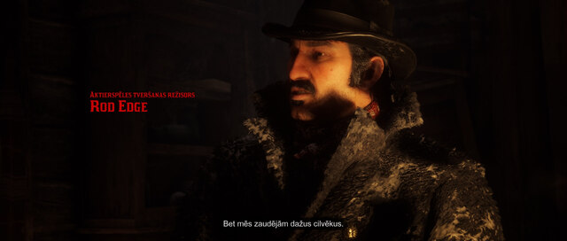
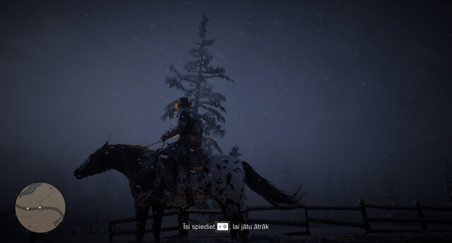
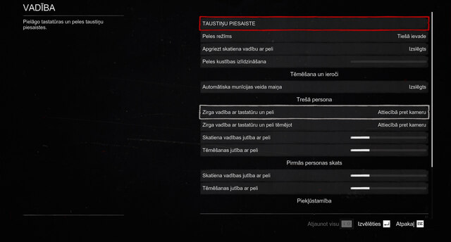
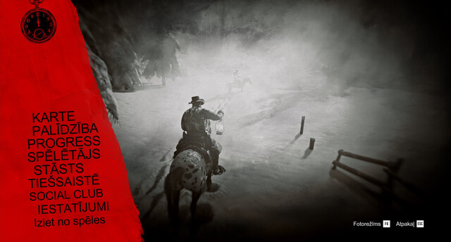
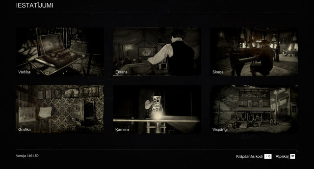
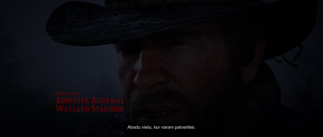
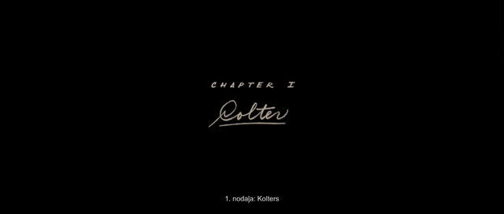

# REYRUN · Red Dead Redemption 2 in Latvian

English · [Latviski](README.lv.md) · [Русский](README.ru.md)

You’re playing Red Dead Redemption 2. By the time you’ve worked out what Dutch said in English, you’ve missed his next line. In a Western this good, you want to hear the whole story.

The original game has no Latvian voices or subtitles. With help from AI, I’ve translated the subtitles, menus and mission objectives. You hear the original English and read along in Latvian. The translation is completely free to download, install and use.

Have the English game on your Windows PC? Paste this page’s address into your usual AI chat for help installing the translation.

[https://reyrun-rdr2-latviski.runcisreinis.chatgpt.site/en/](https://reyrun-rdr2-latviski.runcisreinis.chatgpt.site/en/)

If you use ChatGPT, you already use a chatbot. To give it access to the game files, [connect your chat to your computer](https://reyrun-chatbot-bridge.runcisreinis.chatgpt.site/en/).

This is an amateur translation. I looked words up in thesauruses and compared how the same lines read in other languages. I could follow everything in the parts I played myself. [If you’d like to support my work, thank you.](https://reyrun-rdr2-latviski.runcisreinis.chatgpt.site/en/#support)

Instructions for your assistant and downloads

If you have a fresh copy of the game in English, you’ll also need a translation plug-in and a loader from their authors. Your assistant can help you get them. On your first install you may need to sign in to Nexus Mods or approve a download.

**[Download the translation installer](https://reyrun-chatbot-bridge.runcisreinis.chatgpt.site/launchers/REYRUN-RDR2-Install-XML.cmd)**. Close the game, then download and open the Windows installer. It finds the game folder and installs the translation if it recognizes both required files. If it finds several copies of the game or none at all, choose the folder containing RDR2.exe. The automatic installer checks for a specific version of the [ThirteenAG](https://github.com/ThirteenAG/Ultimate-ASI-Loader) loader. The manual instructions below also cover the loader supplied with Script Hook RDR2. [Restore the previous translation](https://reyrun-chatbot-bridge.runcisreinis.chatgpt.site/launchers/REYRUN-RDR2-Restore-XML.cmd).

**[Download the Windows launcher](https://reyrun-chatbot-bridge.runcisreinis.chatgpt.site/launchers/REYRUN-rdr2-Windows.cmd)** · **[Download the translation ZIP](https://reyrun-rdr2-latviski.runcisreinis.chatgpt.site/download/REYRUN-RDR2-LV.zip)** · [Open the project website](https://reyrun-rdr2-latviski.runcisreinis.chatgpt.site/en/)

[Support Reinis](#ways-to-support-me) · [Installation skill](skills/reyrun-rdr2-lv-install/SKILL.md) · [Translation skill](skills/reyrun-game-translation-lv/SKILL.md)

## Latvian in the game

Click any of Reinis’s screenshots to open the full-size image.

Dialogue subtitles · An on-screen riding prompt · Key mapping

Pause menu · Game settings · Opening credits

Chapter title caption

One mission objective in the downloadable XML reads **“Seko Dačam”** (“Follow Dutch”, entry `0x1C4EF867`).

## Install with your AI assistant

Paste this request into your AI chat.

Paste the copied message into your chat. [Copy the page address](https://reyrun-rdr2-latviski.runcisreinis.chatgpt.site/en/)

**[Download the Windows launcher](https://reyrun-chatbot-bridge.runcisreinis.chatgpt.site/launchers/REYRUN-rdr2-Windows.cmd)** Open the downloaded .cmd file. It looks for your Steam, Rockstar or Epic installation and prepares a copy of the translation XML in the REYRUN workspace after verifying its SHA-256 checksum. If prompted, choose the folder containing RDR2.exe. Follow the guide to install the translator plug-in and ASI loader and copy the XML into the game folder. [Open the RDR2 connection guide](https://reyrun-chatbot-bridge.runcisreinis.chatgpt.site/en/#rdr2) · [Bridge tools and source on GitHub](https://github.com/runcisreinis-glitch/REYRUN-Chatbot-Bridge)

[Full installation guide for AI](docs/INSTALL-AI-en.md) · [Download the installation skill](downloads/REYRUN-RDR2-Install-Skill.zip?raw=true)

## A note from Reinis

My name is Reinis Runcis. This translation is my way of thanking the people who help me keep living in my own home. It’s a gift to anyone who’d like to play through this story in Latvian.

I’ve lived alone for many years. Lately my care and everyday expenses have been costing me more than I have coming in. If you’d like to help, please give only what you can comfortably spare. I still think life is wonderful, and it would mean a lot to me if something I’ve made helps you keep going on a hard day.

If you’d like to get to know me, read my poetry or ask about my other work, [write to me on Facebook](https://www.facebook.com/reinis.runcis).

### Ways to support me

My support page lists the ways to help, including a bank transfer to Swedbank, Stripe, PayPal and USDT. [Support Reinis](https://reyrun-rekursive-deep-search.runcisreinis.chatgpt.site/support.html)

## Translate another game into Latvian

Start with the [practical guide](skills/reyrun-game-translation-lv/references/GUIDE-en.md). You can give the [REYRUN skill](skills/reyrun-game-translation-lv/SKILL.md) to your AI assistant or follow the same steps with a human translator. The examples and Python tools run locally. They let you try a small batch, catch damaged placeholders and compare edited text against its source before you touch a game installation.

The [RDR2 project retrospective](docs/RETROSPECTIVE-en.md) follows the work from drafts to the installed XML. It explains where time was lost, how existing translations were recovered after interruptions, and which measurements tell you how many lines a player can actually read.

[Advanced methods and in-game checks](skills/reyrun-game-translation-lv/references/ADVANCED-en.md) · [Download the translation skill](downloads/REYRUN-Latvian-Game-Translation-Skill.zip?raw=true)

## Install on Windows

1. Close the game and extract the ZIP. In Steam, right-click the game, choose **Manage**, then **Browse local files**. For a non-Steam copy, open the install folder through your launcher. Find `RDR2.exe`.
2. Download **Universal RDR2 String Translator** from [RacerMouze](https://www.nexusmods.com/reddeadredemption2/mods/10214). Place `UniversalRDR2StringTranslator.asi` beside `RDR2.exe`. If you already have a working `dinput8.dll` ASI loader, keep it. Otherwise download [Alexander Blade’s Script Hook RDR2](https://www.dev-c.com/rdr2/scripthookrdr2/) and copy `dinput8.dll` from its `bin` folder beside `RDR2.exe`.
3. Back up any file ending in `Translation.xml` and any older `rdr2-translator.asi` outside the game folder. Copy `Latvian Translation.xml` from the ZIP into the folder beside `RDR2.exe`. Keep the filename as supplied.
4. Leave the game language set to **English**, launch **Story Mode**, and turn on subtitles. Check a menu and a line of dialogue. See the [installation and removal guide](INSTALL-EN.txt) for troubleshooting.

## Download verification

The release contains 253,073 translated entries. The ZIP includes the translation XML and installation guides in Latvian and English. The ASI plug-in and loader are available from their respective authors. The approved database and installed XML matched on every ID and text in the 11 November 2026 check. The screenshots above show how the Latvian text renders in the pictured scenes and menus.

| File | SHA-256 |
| --- | --- |
| `REYRUN-RDR2-LV.zip` | `11d7ee80bac9ac820a2c20e87f2f7fc736e3fab5ceb6e9cf7842543f9f3237da` |
| `Latvian Translation.xml` | `c72337da664b3999ca4fc2de2600c1e79c551b29fa1e69d79d1330485aef5045` |

## Use and sharing

You may use, copy, share and adapt REYRUN’s translation, method and accompanying tools free of charge, for any purpose. This permission covers Reinis Runcis’s contributions. The underlying game, its assets and the third-party tools belong to their respective rights holders.

If you find an odd line or a missing Latvian accent, send Reinis the line as it appeared and where you saw it. [Contact Reinis on Facebook](https://www.facebook.com/reinis.runcis).
