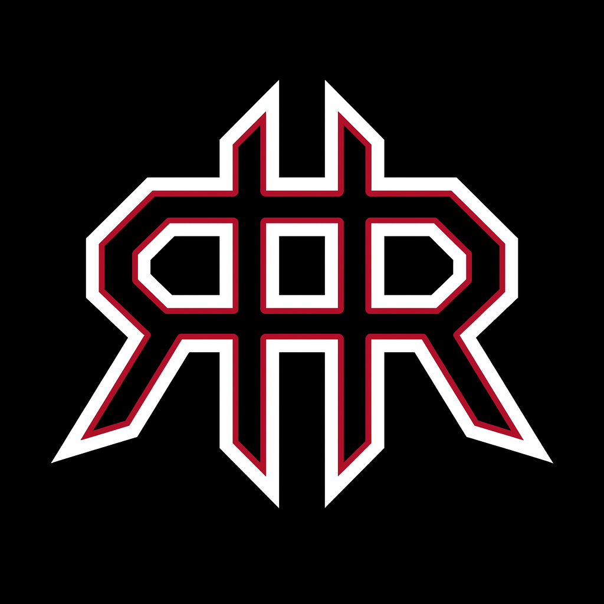
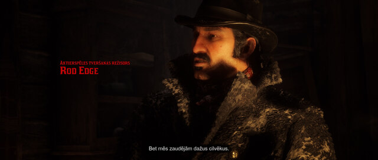
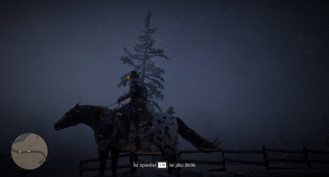
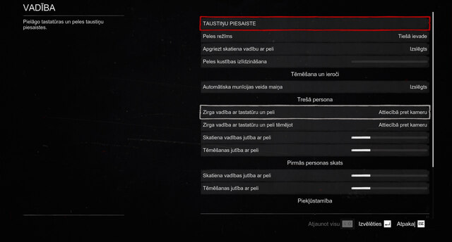
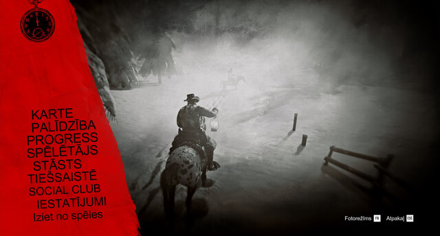
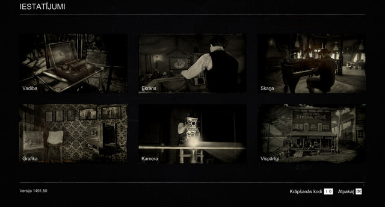
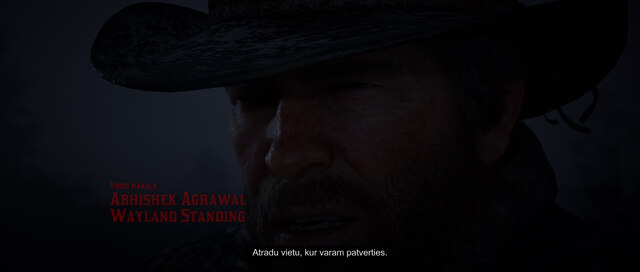
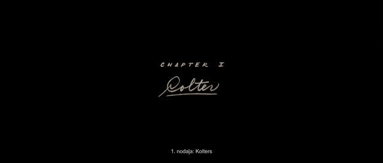

# REYRUN · Red Dead Redemption 2 на латышском

[Latviski](README.lv.md) · [English](README.md) · Русский

Вы играете в Red Dead Redemption 2. Пока разбираете одну фразу Датча по-английски, пропускаете следующую. В таком вестерне хочется понимать каждое слово.

В оригинале нет ни латышской озвучки, ни латышских субтитров. С помощью искусственного интеллекта я перевёл субтитры, меню и задания. Герои говорят по-английски, а вы читаете по-латышски. Скачать, установить и использовать перевод можно совершенно бесплатно.

Игра на английском уже стоит на компьютере с Windows? Вставьте адрес этой страницы в свой чат с искусственным интеллектом. Он поможет установить перевод.

[https://reyrun-rdr2-latviski.runcisreinis.chatgpt.site/ru/](https://reyrun-rdr2-latviski.runcisreinis.chatgpt.site/ru/)

Если вы переписываетесь с ChatGPT, вы уже пользуетесь чат-ботом. Чтобы он мог открыть файлы игры, [подключите чат к компьютеру](https://reyrun-chatbot-bridge.runcisreinis.chatgpt.site/ru/).

Это любительский перевод. Я подбирал слова по словарям синонимов и сравнивал, как одна и та же мысль звучит на разных языках. В тех эпизодах, которые я прошёл сам, мне всё было понятно. [Если захотите поддержать мою работу, заранее спасибо!](https://reyrun-rdr2-latviski.runcisreinis.chatgpt.site/ru/#support)

Инструкция для помощника и загрузки

Если у вас установлена только английская версия игры, понадобятся ещё плагин перевода и его загрузчик. Их можно скачать у авторов. Помощник подскажет, где их взять. При первой установке может потребоваться вход на Nexus Mods или подтверждение загрузки.

**[Скачать программу для Windows](https://reyrun-chatbot-bridge.runcisreinis.chatgpt.site/launchers/REYRUN-rdr2-Windows.cmd)** · [Скачать ZIP с переводом](https://reyrun-rdr2-latviski.runcisreinis.chatgpt.site/download/REYRUN-RDR2-LV.zip) · [Сайт проекта на русском](https://reyrun-rdr2-latviski.runcisreinis.chatgpt.site/ru/)

## Как установить

**[Скачать программу установки перевода](https://reyrun-rdr2-latviski.runcisreinis.chatgpt.site/download/REYRUN-RDR2-Setup.cmd)**. Закройте игру, скачайте и откройте программу установки для Windows. Она найдёт игру, проверит плагин и при необходимости скачает перевод и загрузчик. Если копий игры несколько или программа не найдёт ни одной, укажите папку с RDR2.exe. Автоматическая установка рассчитана на конкретную версию загрузчика [ThirteenAG](https://github.com/ThirteenAG/Ultimate-ASI-Loader). В инструкции по ручной установке ниже описан также загрузчик из архива Script Hook RDR2. [Вернуть предыдущий перевод](https://reyrun-chatbot-bridge.runcisreinis.chatgpt.site/launchers/REYRUN-RDR2-Restore-XML.cmd).

Для первой установки откройте скачанный файл .cmd. Он ищет установку Steam, Rockstar или Epic и готовит проверенную по SHA-256 копию перевода в рабочей папке REYRUN. По запросу выберите папку, где лежит RDR2.exe. Для самой игры нужны плагин Universal RDR2 String Translator и загрузчик ASI. В инструкции указаны ссылки авторов, порядок резервного копирования и необходимые файлы.

[Инструкция по установке и восстановлению](docs/INSTALL-AI-ru.md) · [Скачать умение (skill) для установки](downloads/REYRUN-RDR2-Install-Skill.zip?raw=true)

Если вам помогает ИИ, отправьте ему эту просьбу:

Вставьте скопированную просьбу в свой чат. [Скопировать адрес страницы](https://reyrun-rdr2-latviski.runcisreinis.chatgpt.site/ru/)

## Кадры из сюжетного режима

Нажмите на кадр Рейниса, чтобы открыть его в полном размере.

В файле перевода цель с ID `0x1C4EF867` отображается как «Seko Dačam» («Следуй за Датчем»).

## Как перевести другую игру

Начните с [практического руководства](skills/reyrun-game-translation-lv/references/GUIDE-ru.md). На пяти строках можно попробовать вычитку, проверить служебные вставки и сравнить переведённый текст с исходником. Инструкции подходят и человеку, и ИИ-помощнику. Примеры и инструменты Python запускаются локально.

[Умение (skill) для перевода](skills/reyrun-game-translation-lv/SKILL.md) · [Проверки в игре](skills/reyrun-game-translation-lv/references/ADVANCED-ru.md) · [Опыт проекта RDR2](docs/RETROSPECTIVE-ru.md) · [Скачать умение (skill) для перевода](downloads/REYRUN-Latvian-Game-Translation-Skill.zip?raw=true)

## От Рейниса

Меня зовут Рейнис Рунцис. Этим переводом я хочу поблагодарить тех, кто помогает мне и дальше жить у себя дома. Я дарю его каждому, кому хочется пройти эту историю на латышском.

Я много лет живу один. В последнее время на уход и повседневные расходы уходит больше, чем я получаю. Если захочется помочь, пожалуйста, переводите только столько, сколько можете себе позволить. Я по-прежнему думаю, что жизнь прекрасна. И мне будет очень дорого знать, что кому-то в трудный день помогло то, что я сделал.

Если хотите познакомиться, почитать мои стихи или спросить о других работах, [напишите мне в Facebook](https://www.facebook.com/reinis.runcis). На [странице поддержки](https://reyrun-rekursive-deep-search.runcisreinis.chatgpt.site/support.ru) можно выбрать перевод на счёт в Swedbank, Stripe, PayPal или USDT.

## Как проверить файлы

В выпуске 253 073 текстовые записи. При сверке 11 ноября 2026 года у всех утверждённых записей совпали ID и тексты в установленном XML. В ZIP находятся сам XML и инструкции на латышском и английском. Русская инструкция доступна [отдельно](docs/INSTALL-AI-ru.md).

| Файл | SHA-256 |
| --- | --- |
| REYRUN-RDR2-LV.zip | `11d7ee80bac9ac820a2c20e87f2f7fc736e3fab5ceb6e9cf7842543f9f3237da` |
| Latvian Translation.xml | `c72337da664b3999ca4fc2de2600c1e79c551b29fa1e69d79d1330485aef5045` |

## Использование

Перевод REYRUN, методику и приложенные инструменты можно бесплатно использовать, копировать, менять и распространять для любых целей. Разрешение относится к вкладу Рейниса Рунциса. Игра, её материалы и сторонние инструменты принадлежат их правообладателям. Если заметите странную реплику или пропущенный диакритический знак, пришлите Рейнису текст и укажите, где он встретился.
